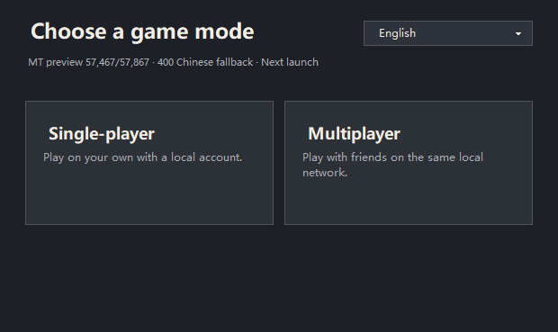
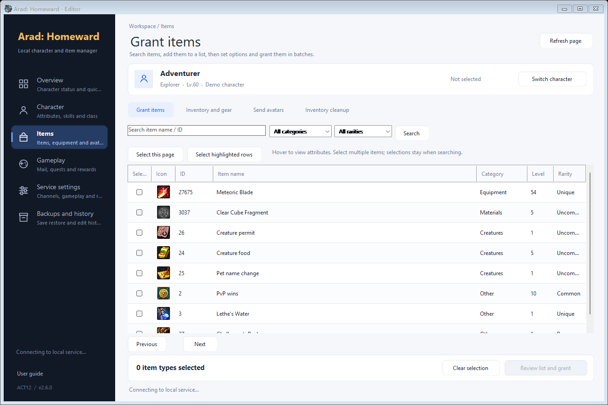

# Arad Homeward

[English](README.md) · [简体中文](README.zh-CN.md)

A portable Windows ACT12 / level-60 local game package with a name-only account launcher, a native desktop trainer, and five display languages. Custom launcher, trainer and localization work by **eirros**.

**[Windows download](https://github.com/a16036868481/AradHomeward/releases)** · **[Illustrated user guide](docs/USAGE.en.md)** · **[中文图文说明](docs/USAGE.zh-CN.md)**

`AradHomeward-v2.6.0-preview.40-win-x64.zip` is the full Windows package with the game, local server, native editor and LAN rooms.

Extract into a new folder to try the release while preserving any existing installation and saves. Open `AradHomeward.exe` in the top-level folder.

## Start playing

1. Fully extract the release ZIP to a writable folder, for example `D:\Games\AradHomeward`. Do not run it inside the archive.
2. Run **AradHomeward.exe**, choose your language and select **Single-player**.
3. On first use, enter an account **name** and click **Save account**.
4. Select the saved account, click **Play solo**, then create or choose a character.
5. The game and **Arad Trainer** open together. Background services remain hidden. Choose **End Game** inside the game to close the related tools and services and save a backup.

The standard package requires **Windows 10 (1607 or later) or Windows 11, 64-bit**. Python and the trainer's dependencies are included. No cloud account, database installation or separate Python installation is needed.

## Included features

- Saved local accounts selected by name; a fresh download starts with no personal accounts or characters.
- **Multiplayer** has **Host a room** and **Join a room**. The host selects a local account. Guests join with an invitation and a player name. [LAN room guide](docs/LAN.md)
- Native Windows trainer: gold, Cera, level, SP, class, inventory, quests, mail, gameplay and channels.
- Item icons, name/ID search, multiple selection, quantities, reinforcement, amplification and hover details.
- Launcher, supported game text/interface resources and trainer language selection: Simplified Chinese, Traditional Chinese, English, Japanese and Korean.
- Local backups, startup diagnostics, relay-port checks and automatic shutdown after the game exits.
- A unique loopback login certificate generated locally on first run. No user's login secret or private certificate is distributed.

## Current release status

**v2.6.0-preview.40** adds four town movement speeds and a separate hold-to-repeat switch. The switch remembers the repeat rate and key when turned off.

Open **System menu → Settings** from the game's bottom bar. The original panel includes **Window size** up to 2880 × 2160. Under **Controls**, choose a town walking pace, switch hold-to-repeat on or off, or open **Gamepad** to set controller bindings. Select **Save** to apply your changes.

The first-use game mixer remains one quarter of the current Windows output volume. After a LAN disconnect, **Rejoin room** opens with the previous invitation and player name.

Language changes apply to the **next game launch**. Some original game text and voices remain. [Release changes](CHANGELOG.md) · [Troubleshooting](docs/USAGE.en.md#troubleshooting)

The pictures are native interface renders with **Explorer / Adventurer demo data**, not a bundled playable save.

## Files and source

| File or folder | Purpose |
| --- | --- |
| `AradHomeward.exe` | Choose a game mode and start the game |
| `AradTrainer.exe` | Open the trainer separately |
| `StopAll.exe` | Emergency/manual shutdown when needed |
| `CheckStartup.exe` | Collect local startup diagnostics |
| `DNF60_ACT12/` | Game, resources, local server and saves |
| `docs/` | Offline English and Chinese illustrated guides |

This repository contains the custom C#, Python and C++ source. Download the release for the complete playable data. See [build notes](docs/BUILD.md) and [release changes](CHANGELOG.md).

## Rights and notices

Custom contributions: Copyright © 2026 **eirros**. All rights reserved, with personal local use of the official release permitted as described in [LICENSE.txt](LICENSE.txt). This public repository is **not an MIT-licensed project**. Original game assets and third-party components retain their respective ownership and licenses; see [THIRD_PARTY_NOTICES.md](THIRD_PARTY_NOTICES.md).
