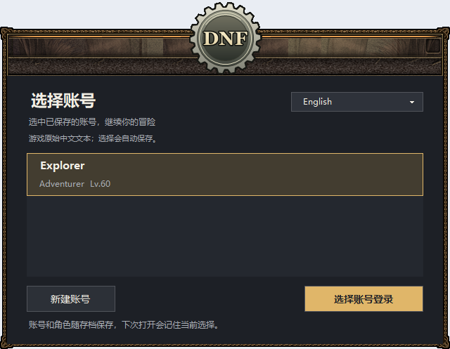
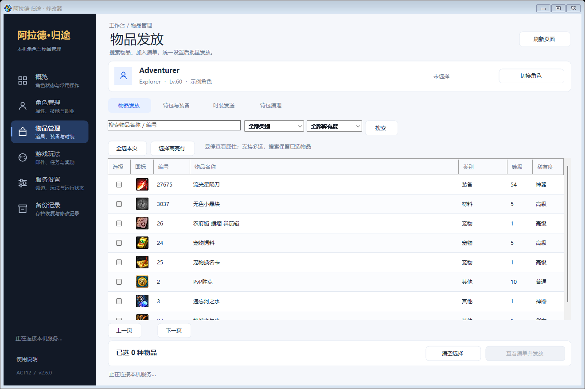

# Arad Homeward · 阿拉德·归途

[English](README.md) · [简体中文](README.zh-CN.md)

Windows ACT12 / 60 版本本地游戏整合包，包含只填名称的账号选择器、原生桌面修改器和五种显示语言。启动器、修改器及本项目的本地化改动由 **eirros** 制作。

**[下载 Windows 压缩包](https://github.com/a16036868481/AradHomeward/releases)** · **[中文图文说明](docs/USAGE.zh-CN.md)** · **[English guide](docs/USAGE.en.md)**

请在 Release 的 **Assets** 中下载 `AradHomeward-v2.6.0-preview.23-win-x64.zip`。GitHub 自动生成的 **Source code** 是自编代码，不是完整游戏包。

## 开始游戏

1. 将 ZIP **完整解压**到有写入权限的目录，例如 `D:\Games\AradHomeward`，不要在压缩包里直接运行。
2. 打开 **AradHomeward.exe**，在启动器右上角选择语言。
3. 首次使用只需填写账号**名称**并点“创建账号”，无需账号编号或密码。
4. 选择保存的账号并点“选择账号登录”，进入游戏后创建或选择角色。
5. 游戏和修改器会一起打开，服务在后台隐藏运行。在游戏内点“结束游戏”，相关修改器和后台服务会自动关闭，并保存备份。

本包适用于 **Windows 10/11 64 位**。已包含 Python 及修改器依赖，无需安装数据库或另装 Python，也不需要注册云端账号。

## 包含功能

- 按名称创建、保存和选择本地账号；公开包从空账号、空角色开始。
- 原生桌面修改器：金币、商城点券、等级、SP、职业、背包、任务、邮件、玩法及频道管理。
- 物品图标、名称/编号搜索、多选、数量、强化、增幅及悬停属性详情。
- 启动器、已覆盖的游戏文本/界面资源和修改器联动切换：简体中文、繁体中文、英语、日语、韩语。
- 本地备份、启动诊断、中继端口检查及退出游戏后自动收尾。
- 首次运行在新电脑生成独立的本地登录证书，公开包不含个人密码、私钥或存档。

## 当前版本说明

**v2.6.0-preview.23** 为翻译预览版。非中文语言包含机器翻译和人工修正，仍有部分原文、图片文字和原始语音。玩家输入的账号名、角色名和聊天内容保持原样。语言切换在**下次启动游戏**时应用。

已完成本机独立运行环境、空账号创建、物品资料与图标、本地证书和语言资源哈希检查。不同电脑的实际游戏兼容性仍需在对应电脑上验证；出现问题请看[故障排查](docs/USAGE.zh-CN.md#打不开时怎么处理)。

示例图片由原生界面组件生成，使用 **Explorer / Adventurer 虚构数据**，不代表压缩包带有这些账号或角色。

## 文件入口

| 文件或目录 | 用途 |
| --- | --- |
| `AradHomeward.exe` | 打开账号选择器并开始游戏 |
| `AradTrainer.exe` | 单独打开修改器 |
| `StopAll.exe` | 异常时手动收尾的备用入口 |
| `CheckStartup.exe` | 生成本机启动检查结果 |
| `app/` | 游戏、资源、独立运行环境、本地存档与后台组件 |
| `docs/` | 可离线查看的中英文图文说明 |

仓库包含本项目自编 C#、Python、C++ 源码，完整可玩数据请从 Release 下载。编译方法见[构建说明](docs/BUILD.md)，版本内容见[更新记录](CHANGELOG.md)。

## 版权与许可

自编改动：Copyright © 2026 **eirros**。保留所有权利；官方发布包允许按 [LICENSE.txt](LICENSE.txt) 进行个人本地使用。公开源码不代表采用 MIT 许可。原游戏资源及第三方组件继续适用原有权利与许可，详见[第三方说明](THIRD_PARTY_NOTICES.md)。
