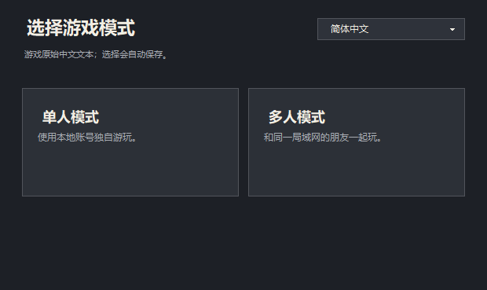
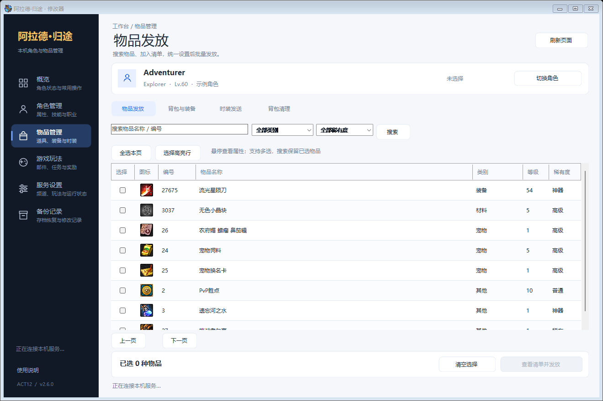

# Arad Homeward · 阿拉德·归途

[English](README.md) · [简体中文](README.zh-CN.md)

Windows ACT12 / 60 版本本地游戏整合包，包含只填名称的账号选择器、原生桌面修改器和五种显示语言。启动器、修改器及本项目的本地化改动由 **eirros** 制作。

**[下载 Windows 版](https://github.com/a16036868481/AradHomeward/releases)** · **[中文图文说明](docs/USAGE.zh-CN.md)** · **[English guide](docs/USAGE.en.md)**

`AradHomeward-v2.6.0-preview.46-win-x64.zip` 是 Windows 10 和 Windows 11 完整包，包含游戏、本机服务、桌面修改器和局域网房间。同一发布页提供单独的 Windows 7 SP1 64 位兼容测试包。

解压到新文件夹即可试用，原安装目录里的存档可继续保留。双击解压目录最外层的 `AradHomeward.exe` 启动。

## 开始游戏

1. 将 ZIP **完整解压**到有写入权限的目录，例如 `D:\Games\AradHomeward`，不要在压缩包里直接运行。
2. 打开 **AradHomeward.exe**，在右上角选择语言，再点「单人模式」。
3. 首次使用时填写账号**名称**，点「保存账号」。
4. 选择保存的账号并点「开始单人游戏」，进入游戏后创建或选择角色。
5. 游戏和修改器会一起打开，服务在后台隐藏运行。在游戏内点“结束游戏”，相关修改器和后台服务会自动关闭，并保存备份。

标准包要求 **64 位 Windows 10（1607 或更新版本）或 Windows 11**。包内已包含 Python 及修改器依赖，无需安装数据库或另装 Python，也不需要注册云端账号。

## 包含功能

- 按名称创建、保存和选择本地账号；公开包从空账号、空角色开始。
- 「多人模式」提供「创建房间」和「加入房间」。房主选择本地账号，来宾凭邀请和玩家名称加入。[局域网说明](docs/LAN.md)
- 原生桌面修改器：金币、商城点券、等级、SP、职业、背包、任务、邮件、玩法及频道管理。
- 物品图标、名称/编号搜索、多选、数量、强化、增幅及悬停属性详情。
- 启动器、已覆盖的游戏文本/界面资源和修改器联动切换：简体中文、繁体中文、英语、日语、韩语。
- 本地备份、启动诊断、中继端口检查及退出游戏后自动收尾。
- 首次运行在新电脑生成独立的本地登录证书，公开包不含个人密码、私钥或存档。

## 当前版本说明

**v2.6.0-preview.46** 修复 GM 强制下线。每次只下线选中的城镇假人或摆摊假人。Windows 7 SP1 兼容测试包修复了批量发放列表和 GM 道具选择器。远古精灵的秘药在发放列表中使用编号 7440。

系统缺少 `QueueUserAPC2` 时，启动器自动使用随包的 64 位兼容登录服务。Windows 7 SP1 兼容测试包使用 64 位 .NET 6 登录服务。两条路径均在 Windows 11 模拟缺少接口时通过测试，Win7 和受影响的 Win10 版本仍待实机验收。 [验证记录](VALIDATION.json)

打开 **GM 工具 → 概览 → 城镇移动速度**，输入 0–100 的整数并保存。0% 停止移动，100% 恢复原速。

进入游戏后，打开底栏的 **系统菜单 → 游戏设置**。「窗口大小」最高可选 2880 × 2160。在「操作」页可开启或关闭连发，或进入「手柄」调整绑定。点「保存」即可在游戏内应用修改。

首次使用的默认游戏音量仍为当前 Windows 输出音量的四分之一。局域网掉线后可通过「重新加入房间」沿用原邀请和玩家名称。

语言切换在**下次启动游戏**时应用，部分游戏文字和语音仍使用原语言。[更新记录](CHANGELOG.md) · [故障排查](docs/USAGE.zh-CN.md#打不开时怎么处理)

示例图片由原生界面组件生成，使用 **Explorer / Adventurer 虚构数据**，不代表压缩包带有这些账号或角色。

## 文件入口

| 文件或目录 | 用途 |
| --- | --- |
| `AradHomeward.exe` | 选择游戏模式并开始游戏 |
| `AradTrainer.exe` | 单独打开修改器 |
| `StopAll.exe` | 异常时手动收尾的备用入口 |
| `CheckStartup.exe` | 生成本机启动检查结果 |
| `DNF60_ACT12/` | 游戏、资源、本机服务和存档 |
| `docs/` | 可离线查看的中英文图文说明 |

仓库包含本项目自编 C#、Python、C++ 源码，完整可玩数据请从 Release 下载。编译方法见[构建说明](docs/BUILD.md)，版本内容见[更新记录](CHANGELOG.md)。

## 版权与许可

自编改动：Copyright © 2026 **eirros**。保留所有权利；官方发布包允许按 [LICENSE.txt](LICENSE.txt) 进行个人本地使用。公开源码不代表采用 MIT 许可。原游戏资源及第三方组件继续适用原有权利与许可，详见[第三方说明](THIRD_PARTY_NOTICES.md)。
