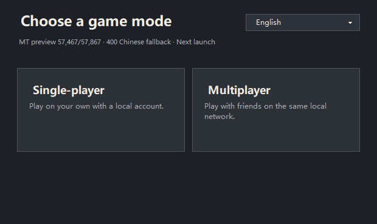
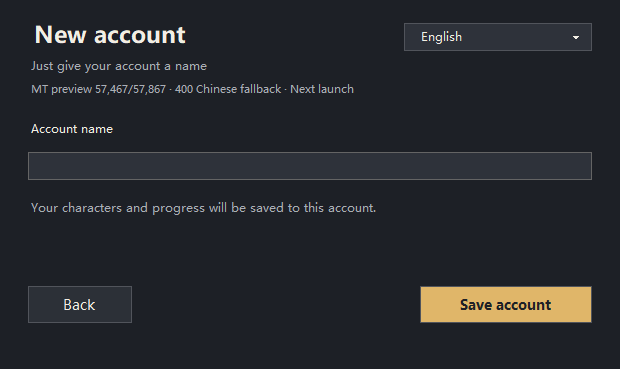
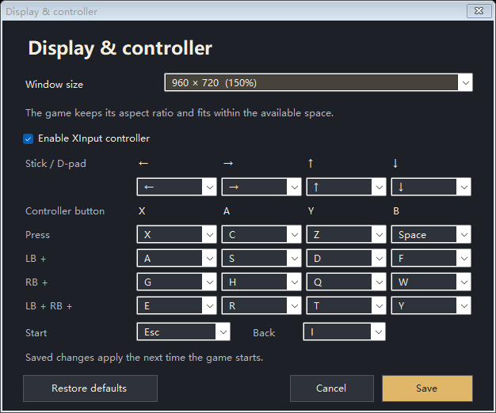
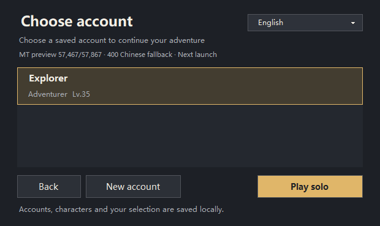
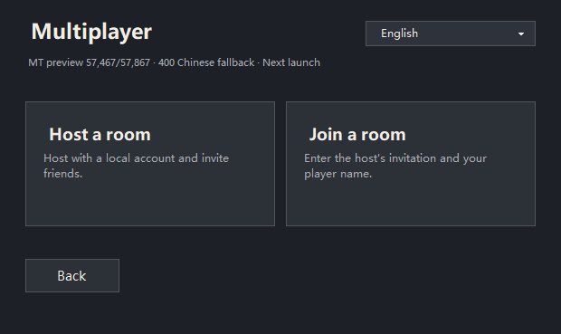
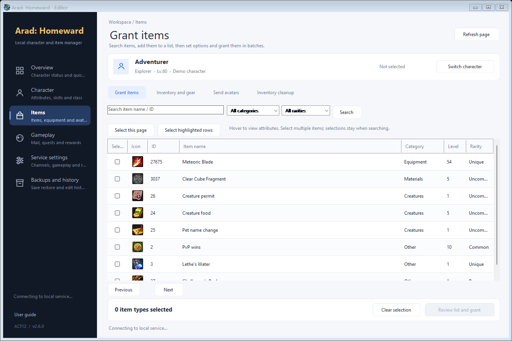

# Illustrated user guide

[Home](../README.md) · [中文图文说明](USAGE.zh-CN.md)

## 1. Download and extract

Extract the whole `AradHomeward-v2.6.0-preview.38-win-x64.zip` to a new writable local folder, such as `D:\Games\AradHomeward`. Open `AradHomeward.exe` directly in that folder.

Keep the extracted files and folders together. The package requires Windows 10 or 11 x64.

To verify integrity in PowerShell, run `Get-FileHash .\AradHomeward-v2.6.0-preview.38-win-x64.zip -Algorithm SHA256` and compare the result with `SHA256SUMS.txt`.

## 2. Choose a mode and create a local account

Double-click **AradHomeward.exe** and choose **Single-player** or **Multiplayer**.

When you first choose **Single-player**, enter an account name and select **Save account**. The name identifies your local saves.

The local server creates the internal credentials automatically. Keep the extraction folder to preserve your saves.

## 3. Choose a language and start playing

Open **Display & controller** at the bottom right of the launcher to change window size or controller bindings. The default window size is 960 × 720. Other choices are 640 × 480, 800 × 600, 1120 × 840, 1280 × 960 and **Fit to screen**. The game keeps a 4:3 aspect ratio.

On an Xbox or other XInput controller, use the left stick or D-pad to move, **X** to attack, **A** to jump and **Y** to use a skill. Hold **LB**, **RB** or both while pressing a face button to use more shortcuts. Save your choices and start the game to apply them.

Choose a saved account and select **Play solo**. The launcher remembers your selection. Use **New account** to create another local account.

The language menu offers **简体中文 / 繁體中文 / English / 日本語 / 한국어**. It controls the launcher, supported game resources and trainer. Exit the game before changing language, then start it again. Player names and text that you type are not translated.

This is a translation preview: some original text, bitmap text and voices remain; automatic translations can be inaccurate. The launcher displays coverage and fallback information. It does not claim support for every world language.

## 4. Play on the local network

1. On the host PC, choose **Multiplayer**, then **Host a room**. Create or select a local account and choose **Host a room**. Once the room opens, select **Copy invitation**.
2. On the guest PC, choose **Multiplayer**, then **Join a room**. Paste the invitation, enter a player name and select **Connect and play**.
3. Both players choose the same channel. The host PC saves guest progress.

Both PCs use the same build and share a LAN or a virtual LAN such as Radmin VPN. The room panel shows the guest count. Copy its invitation and send it to your friends. The game chooses the network path automatically. [LAN room guide](LAN.md)

## 5. Play and use the trainer

Create or choose a character in the game. The native trainer opens with the game. You can make supported online edits in town or in Seria's room. Choose your character at the top right of the trainer.

On first use of an output device, the game sets its default mixer volume to one quarter of that device's current Windows volume. For example, 40% in Windows sets the game to 10%. Adjustments in Windows Volume Mixer are used on later starts.

| Page | Use |
| --- | --- |
| Overview | Character status and shortcuts |
| Character | Gold, Cera, level, SP, class and attributes |
| Items | Search, multi-select, quantities, reinforcement, amplification, inventory and avatars |
| Gameplay | Mail, quests, contracts and rewards |
| Service settings | Channels, rules, events and local service status |
| Backups and history | Save snapshots and previous operations |

For items, search by selected-language name, original name or ID. Check the desired items, open **Review list and grant**, set quantities and equipment options, review the target character, then confirm the grant. Reinforcement/amplification levels range from **0–31**; amplification stat values range from **0–65535**. Availability and offline requirements are shown by each operation.

Hover over the icon or name for details. Double-click the item name or press **Alt + Enter** for full details. Items delivered directly to inventory do not leave an empty attachment mail; unclaimed attachments remain in the mailbox.

Character sections save separately. A class change reconfigures skills. Full attribute edits and inventory deletion require the character to be offline. Read the prompt shown for an operation before applying it.

## 6. Exit and keep saves

Choose **End Game inside the game**. The session manager closes the related trainer and background services and creates a save backup. Normally there is no need to run `StopAll.exe`; it is a fallback for an interrupted session. Allow shutdown to finish before copying or replacing files.

The primary save is `DNF60_ACT12/ACT12_Server/dnf_a12.sqlite`. Automatic backups are stored under `backups/`. Accounts and the local login certificate belong to this extracted installation. Each PC keeps its own saves.

To move your progress, exit normally on both PCs and copy the **entire extracted folder**. This keeps the save, account secrets, certificate and settings together. Before updating or restoring, keep a separate copy of your current installation. Do not replace an existing save with the empty save from a new public download.

## Troubleshooting

| Symptom | Action |
| --- | --- |
| Missing files, no window, or instant exit | Extract the entire ZIP again to a short writable path and check the archive hash. Keep all folders together. |
| The mode selection window does not appear | Run `AradHomeward.exe` from the extraction folder. For troubleshooting use `CheckStartup.exe` and collect `logs/startup-check.json` and `logs/startup-state.json` if present. |
| Game service fails to start | Run **CheckStartup.exe** and inspect its report and `DNF60_ACT12/ACT12_Server/server_log.txt`. The relay preflight can select a free local port when 5555 is unavailable. |
| Login identity is incomplete or mismatched | Restore the complete installation from its backup. Do not copy certificates from another unrelated installation or disable certificate validation. |
| Some text is still in the original language | Exit, choose the language again and relaunch. Report the language, screen and an image; some original resources remain in this preview. |
| Trainer has no selected character | Enter the character in the game, wait for services to be ready, then use **Switch character**. |

Logs and diagnostics can contain account or character data. Review them before posting a public issue. A clean release contains no existing player's saves, private certificates, historical logs or backups.

All interface images here are **component renders with demo data**. Local component validation is recorded in [VALIDATION.json](../VALIDATION.json); gameplay on your specific PC must be verified on that machine.
