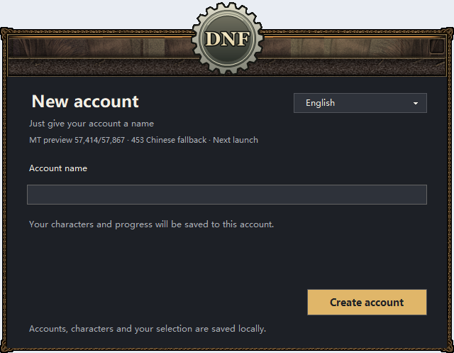
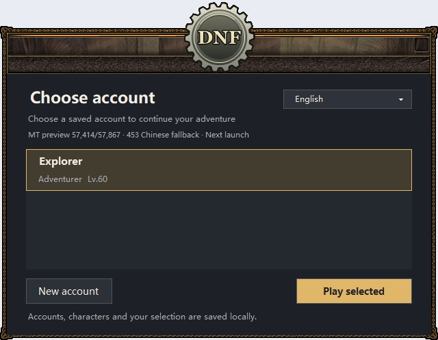
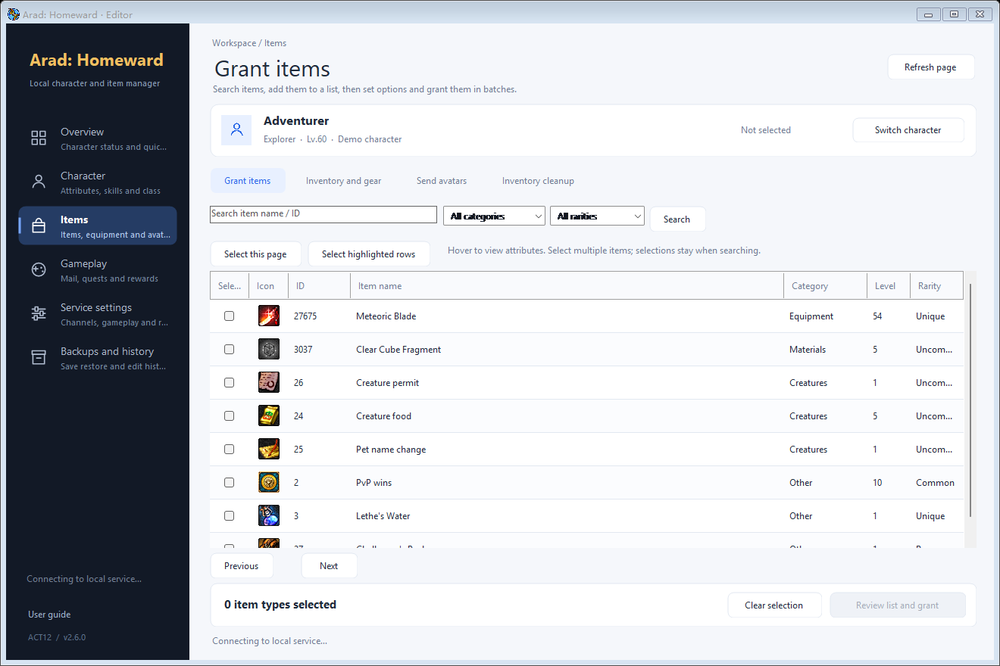

# Illustrated user guide

[Home](../README.md) · [中文图文说明](USAGE.zh-CN.md)

## 1. Download and extract

Open [Releases](https://github.com/a16036868481/AradHomeward/releases) and download `AradHomeward-v2.6.0-preview.23-win-x64.zip` from **Assets**, together with `SHA256SUMS.txt` if you want to verify the download. Extract the whole ZIP to a writable local folder such as `D:\Games\AradHomeward`.

Keep the `app` folder next to all four EXE entries. Do not run from inside the ZIP, move just one EXE, or install into a protected system folder. The download is for Windows 10/11 x64; it is not an Android, macOS or Linux build.

To verify integrity in PowerShell, run `Get-FileHash .\AradHomeward-v2.6.0-preview.23-win-x64.zip -Algorithm SHA256` and compare the result with `SHA256SUMS.txt`.

## 2. Create a local account

Double-click **AradHomeward.exe**. The first screen contains **New account**, because the public package does not contain another player's save. Enter a visible name, then click **Create account**. No password or account number is requested.

The account name labels a local save, not an online identity. The local server creates the internal credentials automatically. Do not delete the `app` folder after playing.

## 3. Choose language and sign in

Choose the saved account and click **Play selected**. Later launches remember your selection. You can create additional named accounts from the same screen.

The language menu offers **简体中文 / 繁體中文 / English / 日本語 / 한국어**. It controls the launcher, supported game resources and trainer. Exit the game before changing language, then start it again. Player names and text that you type are not translated.

This is a translation preview: some original text, bitmap text and voices remain; automatic translations can be inaccurate. The launcher displays coverage and fallback information. It does not claim support for every world language.

## 4. Play and use the trainer

Create or choose a character in the game. The native trainer opens with the game; the console and local services stay in the background. Stay in town while making supported online changes, and choose the target character at the top right of the trainer.

| Page | Use |
| --- | --- |
| Overview | Character status and shortcuts |
| Character | Gold, Cera, level, SP, class and attributes |
| Items | Search, multi-select, quantities, reinforcement, amplification, inventory and avatars |
| Gameplay | Mail, quests, contracts and rewards |
| Service settings | Channels, rules, events and local service status |
| Backups and history | Save snapshots and previous operations |

For items, search by selected-language name, original name or ID. Check the desired items, open **Review list and grant**, set quantities and equipment options, review the target character, then confirm the grant. Reinforcement/amplification levels range from **0–31**; amplification stat values range from **0–65535**. Availability and offline requirements are shown by each operation.

Hover over the icon or name for details. Double-click the item name or press **Alt + Enter** for full details. Items delivered directly to inventory do not leave an empty attachment mail; unclaimed attachments remain in the mailbox.

Character sections save separately. A class change reconfigures skills. Full attribute edits and inventory deletion require the character to be offline. Read the prompt shown for an operation before applying it.

## 5. Exit and keep saves

Choose **End Game inside the game**. The session manager closes the related trainer and background services and creates a save backup. Normally there is no need to run `StopAll.exe`; it is a fallback for an interrupted session. Allow shutdown to finish before copying or replacing files.

The primary save is `app/DNF60_ACT12/ACT12_Server/dnf_a12.sqlite`. Automatic backups are stored under `app/backups/`. Accounts and the local login certificate belong to this extracted installation. Two PCs keep independent saves; there is no cloud sync.

To move your progress, exit normally on both PCs and copy the **entire extracted folder**. This keeps the save, account secrets, certificate and settings together. Before updating or restoring, keep a separate copy of your current installation. Do not replace an existing save with the empty save from a new public download.

## Troubleshooting

| Symptom | Action |
| --- | --- |
| Missing files, no window, or instant exit | Extract the entire ZIP again to a short writable path and check the archive hash. Keep all folders together. |
| Launcher fails on this PC | Exit first. Change `app/setup/launcher-mode.json` from `{"mode":"original"}` to `{"mode":"compat"}`, then start `AradHomeward.exe` again. The same native account pane opens in a compatibility window. |
| Game service fails to start | Run **CheckStartup.exe** and inspect its report plus `app/logs/` and `app/DNF60_ACT12/ACT12_Server/server_log.txt`. The relay preflight can select a free local port when 5555 is unavailable. |
| Login identity is incomplete or mismatched | Restore the complete installation from its backup. Do not copy certificates from another unrelated installation or disable certificate validation. |
| Some text is still in the original language | Exit, choose the language again and relaunch. Report the language, screen and an image; some original resources remain in this preview. |
| Trainer has no selected character | Enter the character in the game, wait for services to be ready, then use **Switch character**. |

Logs and diagnostics can contain account or character data. Review them before posting a public issue. A clean release contains no existing player's saves, private certificates, historical logs or backups.

All interface images here are **component renders with demo data**. Local component validation is recorded in [VALIDATION.json](../VALIDATION.json); gameplay on your specific PC must be verified on that machine.
