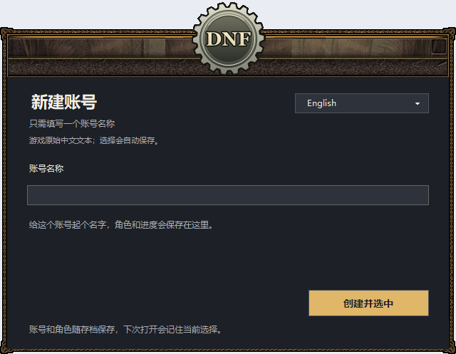

# 中文图文使用说明

[项目主页](../README.zh-CN.md) · [English guide](USAGE.en.md)

## 1. 下载并完整解压

打开 [Releases](https://github.com/a16036868481/AradHomeward/releases)，在 **Assets** 中下载 `AradHomeward-v2.6.0-preview.23-win-x64.zip`。`SHA256SUMS.txt` 是校验文件；GitHub 自动生成的 Source code 不含完整游戏。

完整解压到有写入权限的本地目录，例如 `D:\Games\AradHomeward`。四个 EXE 入口必须和 `app` 文件夹放在一起，不能只移动一个程序，也不要在压缩包里直接打开。本包需要 Windows 10/11 64 位。

需要验证下载时，可在 PowerShell 执行 `Get-FileHash .\AradHomeward-v2.6.0-preview.23-win-x64.zip -Algorithm SHA256`，与 `SHA256SUMS.txt` 对照。

## 2. 第一次创建账号

双击 **AradHomeward.exe**。公开包不附带别人的账号和角色，因此第一次会显示“新建账号”。只填写一个名称并点“创建账号”，不要求输入账号编号或密码。

名称只用于区分本地存档，内部登录凭据由程序自动创建。首次启动还会在这台电脑生成独立的本地登录证书。以后游玩请保留完整的 `app` 文件夹。

## 3. 选择语言和登录

已有账号时，选中保存的账号，再点“选择账号登录”。下次打开会记住选择，也可以继续新建其他名称的账号。

右上角可选择 **简体中文、繁體中文、English、日本語、한국어**。启动器、已覆盖的游戏资源和修改器会跟随选择。切换前先退出游戏，重新启动后应用。玩家自己的账号名、角色名和输入内容保持原样。

当前是翻译预览版，包含机器翻译和人工修正，仍有部分原文、图片文字及原始语音。启动器会显示覆盖量和原文回退量，目前提供上述五种语言。

## 4. 游戏与修改器

进入游戏后新建或选择角色。修改器会自动一起打开，控制台和本地服务隐藏在后台。进行在线修改时先停留在城镇，在修改器右上角选择要管理的角色。

| 页面 | 功能 |
| --- | --- |
| 概览 | 角色状态和常用入口 |
| 角色管理 | 金币、商城点券、等级、SP、职业、属性 |
| 物品管理 | 搜索、多选、数量、强化、增幅、背包及时装 |
| 游戏玩法 | 邮件、任务、契约和奖励 |
| 服务设置 | 频道、规则、活动、运行状态 |
| 备份记录 | 存档快照与修改历史 |

发物品时，用所选语言名称、原名或编号搜索，勾选需要的物品，打开“待发放清单”，填写数量、强化或增幅参数，确认目标角色后发放。强化/增幅等级为 **0～31**，红字属性值为 **0～65535**。各项操作是否需要离线，以页面提示为准。

鼠标停在物品图标或名称上可看详细属性；双击名称或按 **Alt + Enter** 可打开完整详情。直接进入背包的物品不再额外留下空附件邮件，未领取附件的邮件继续保留。

角色属性各区分别保存；修改职业会重设技能。完整属性编辑和背包删除需要角色离线，请按操作提示执行。

## 5. 退出、备份与换电脑

在**游戏内点“结束游戏”**，修改器与相关后台服务会自动一起退出，并创建存档备份。正常情况下不需要再点关闭入口；`StopAll.exe` 只供异常时手动收尾。等退出完成后再复制或替换文件。

主存档位于 `app/DNF60_ACT12/ACT12_Server/dnf_a12.sqlite`，自动备份在 `app/backups/`。账号、本地证书和设置属于当前解压目录，两台电脑的存档各自独立，不会自动同步。

迁移进度时，先在两台电脑正常退出，再复制**整个已解压文件夹**，让存档、内部凭据、证书和设置一起保留。更新或恢复前另存当前目录备份，不要用新公开包的空数据库覆盖已有角色存档。

## 打不开时怎么处理

| 现象 | 处理方法 |
| --- | --- |
| 缺文件、没有窗口或闪退 | 检查压缩包校验值，重新完整解压到较短且可写的目录，保持所有文件夹在一起。 |
| 原版启动器在这台电脑无法显示 | 先退出，将 `app/setup/launcher-mode.json` 中的 `{"mode":"original"}` 改为 `{"mode":"compat"}`，再打开 `AradHomeward.exe`。同一套账号界面会在兼容窗口中显示。 |
| 游戏服务启动失败 | 运行 **CheckStartup.exe**，查看检查结果、`app/logs/` 及 `app/DNF60_ACT12/ACT12_Server/server_log.txt`。中继检查会在 5555 不可用时选择空闲本地端口。 |
| 提示登录证书不完整或不匹配 | 从备份恢复整个安装目录。不要混用其他安装目录的证书，也不要关闭证书验证。 |
| 仍显示部分原始文字 | 退出游戏、重新选择语言并启动。反馈时附上语言、具体页面和截图；预览版仍有少量原始资源。 |
| 修改器未选择角色 | 先在游戏里进入角色，等待服务就绪，再点“切换角色”。 |

日志或检查报告可能包含账号、角色信息，发到公开 Issue 前请先检查。公开压缩包不包含已有玩家存档、私钥、旧日志或备份。

本文图片由**原生组件使用虚构数据生成**，不代表公开包内有这些角色。本机组件检查记录见 [VALIDATION.json](../VALIDATION.json)，其他电脑的实际游玩仍需在对应电脑验收。
