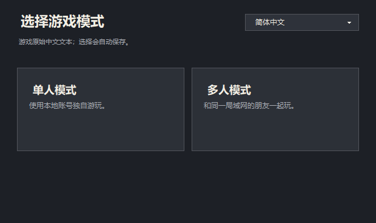
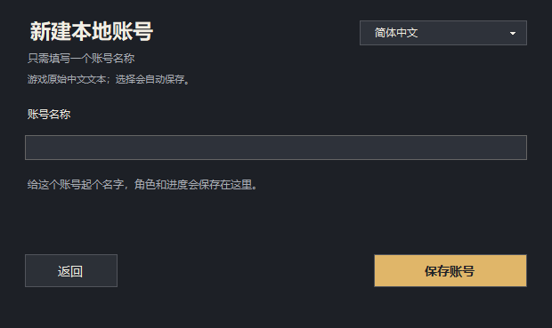
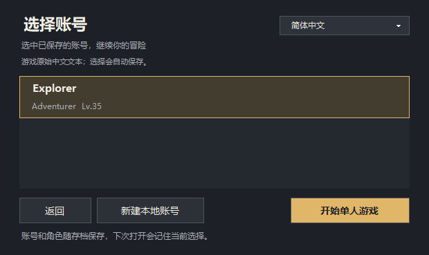
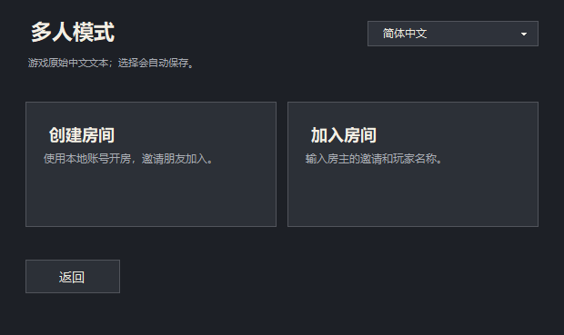
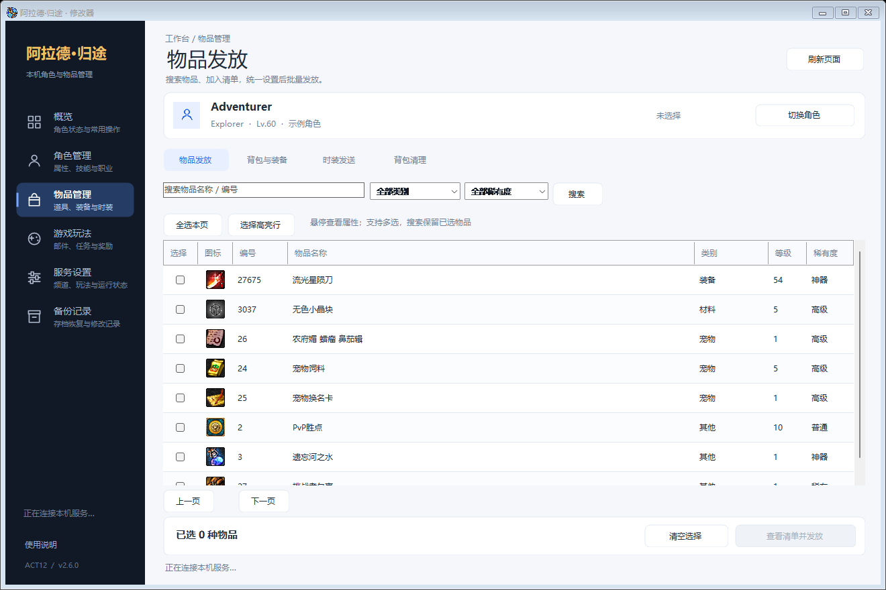

# 中文图文使用说明

[项目主页](../README.zh-CN.md) · [English guide](USAGE.en.md)

## 1. 下载并完整解压

将 `AradHomeward-v2.6.0-preview.39-win-x64.zip` 完整解压到一个新的可写目录，例如 `D:\Games\AradHomeward`。直接打开其中的 `AradHomeward.exe`。

解压后的程序和数据文件夹请一起保留。标准包要求 64 位 Windows 10（1607 或更新版本）或 Windows 11。

需要验证下载时，可在 PowerShell 执行 `Get-FileHash .\AradHomeward-v2.6.0-preview.39-win-x64.zip -Algorithm SHA256`，与 `SHA256SUMS.txt` 对照。

## 2. 选择模式与新建账号

双击 **AradHomeward.exe**，先选「单人模式」或「多人模式」。

首次选择「单人模式」后，填写账号名称并点「保存账号」。

名称用于区分本地存档，内部登录凭据由程序自动创建。首次启动还会在这台电脑生成独立的本地登录证书。请保留完整的解压目录以便继续游玩。

## 3. 选择语言并开始游戏

进入游戏后，点击底栏的 **系统菜单 → 游戏设置**，选择「窗口大小」，再点「保存」。游戏画面保持 4:3，共有 13 档，从 640 × 480 到 2880 × 2160。大窗口可选 1344 × 1008、1440 × 1080、1600 × 1200、1760 × 1320、1920 × 1440、2048 × 1536、2560 × 1920 和 2880 × 2160。「适应屏幕」自动使用可用空间。右侧聊天窗随画面缩放，选定尺寸超过桌面可用空间时会自动缩小。「窗口最大化」使用桌面可用区域，「全屏」使用整个显示器。切回窗口模式后会恢复之前选定的尺寸。

点同一窗口底部的「操作」。「城镇移动速度」可在当前装备原速的 100%、75%、50%、25% 之间切换。「按住连发」默认关闭，可选在副本内每秒输入 4、8 或 12 次。默认连发键是 **X**。如果改过普攻键，点「连发键」，再按对应的字母或数字。松开即停止连发，已经打出的招式会正常收招。

在「操作 → 手柄」可配置 Xbox 及其他 XInput 手柄。点选一个键位后按键盘键，按 **Delete** 可清空该绑定。默认用左摇杆或十字键移动，按 **X** 普攻、**A** 跳跃、**Y** 施放技能。按住 **LB**、**RB** 或两个肩键再按面键，会使用更多技能快捷键。点「保存」即可应用修改。联机时，房主和来宾都需要安装本次操作更新。

选中保存的账号，再点“开始单人游戏”。下次打开会记住你的选择。需要另开存档时，点“新建本地账号”。

右上角可选择 **简体中文、繁體中文、English、日本語、한국어**。启动器、已覆盖的游戏资源和修改器会跟随选择。切换前先退出游戏，重新启动后应用。玩家自己的账号名、角色名和输入内容保持原样。

当前是翻译预览版，包含机器翻译和人工修正，仍有部分原文、图片文字及原始语音。启动器会显示覆盖量和原文回退量，目前提供上述五种语言。

## 4. 局域网联机

1. 房主进入「多人模式 → 创建房间」，新建或选中本地账号后点「创建房间」。房间开放后，点「复制邀请」。
2. 朋友进入「多人模式 → 加入房间」，粘贴邀请、填写玩家名称，再点「连接房间并进入游戏」。
3. 双方进入相同频道，来宾的角色和进度保存在房主电脑上。

两台电脑使用同一版本，并加入同一个局域网或 Radmin VPN 等虚拟局域网。房间窗口显示来宾人数。房主复制一条邀请即可，游戏会自动选择可用连接。[局域网说明](LAN.md)

## 5. 游戏与修改器

进入游戏后新建或选择角色。修改器会随游戏打开。在城镇或赛丽亚房间时，可从修改器右上角选择角色并在线修改。

首次使用某个输出设备时，游戏混音器的默认音量设为该设备当前 Windows 音量的四分之一。例如，Windows 为 40% 时，游戏为 10%。之后在 Windows 音量混音器调整的游戏音量会在下次启动时继续使用。

| 页面 | 功能 |
| --- | --- |
| 概览 | 角色状态和常用入口 |
| 角色管理 | 金币、商城点券、等级、SP、职业、属性 |
| 物品管理 | 搜索、多选、数量、强化、增幅、背包及时装 |
| 游戏玩法 | 邮件、任务、契约和奖励 |
| 服务设置 | 频道、规则、活动、运行状态 |
| 备份记录 | 存档快照与修改历史 |

发物品时，用所选语言名称、原名或编号搜索，勾选需要的物品，打开“待发放清单”，填写数量、强化或增幅参数，确认目标角色后发放。强化/增幅等级为 **0～31**，红字属性值为 **0～65535**。各项操作是否需要离线，以页面提示为准。

鼠标停在物品图标或名称上可看详细属性；双击名称或按 **Alt + Enter** 可打开完整详情。直接进入背包的物品不再额外留下空附件邮件，未领取附件的邮件继续保留。

角色属性各区分别保存；修改职业会重设技能。完整属性编辑和背包删除需要角色离线，请按操作提示执行。

## 6. 退出、备份与换电脑

在**游戏内点“结束游戏”**，修改器与相关后台服务会自动一起退出，并创建存档备份。正常情况下不需要再点关闭入口；`StopAll.exe` 只供异常时手动收尾。等退出完成后再复制或替换文件。

主存档位于 `DNF60_ACT12/ACT12_Server/dnf_a12.sqlite`，自动备份在 `backups/`。账号、本地证书和设置属于当前解压目录，两台电脑各自保存进度。

迁移进度时，先在两台电脑正常退出，再复制**整个已解压文件夹**，让存档、内部凭据、证书和设置一起保留。更新或恢复前另存当前目录备份，不要用新公开包的空数据库覆盖已有角色存档。

## 打不开时怎么处理

| 现象 | 处理方法 |
| --- | --- |
| 缺文件、没有窗口或闪退 | 检查压缩包校验值，重新完整解压到较短且可写的目录，保持所有文件夹在一起。 |
| 模式选择窗口未出现 | 从解压目录打开 `AradHomeward.exe`。若仍未打开，运行 `CheckStartup.exe`，收集 `logs/startup-check.json` 和已生成的 `logs/startup-state.json`。 |
| 游戏服务启动失败 | 运行 **CheckStartup.exe**，查看检查结果和 `DNF60_ACT12/ACT12_Server/server_log.txt`。中继检查会在 5555 不可用时选择空闲本地端口。 |
| 提示登录证书不完整或不匹配 | 从备份恢复整个安装目录。不要混用其他安装目录的证书，也不要关闭证书验证。 |
| 仍显示部分原始文字 | 退出游戏、重新选择语言并启动。反馈时附上语言、具体页面和截图；预览版仍有少量原始资源。 |
| 修改器未选择角色 | 先在游戏里进入角色，等待服务就绪，再点“切换角色”。 |

日志或检查报告可能包含账号、角色信息，发到公开 Issue 前请先检查。公开压缩包不包含已有玩家存档、私钥、旧日志或备份。

登录服务优先使用本机 9999，管理服务优先使用 8080。如果端口已被占用，启动器会选用空闲端口。运行 `CheckStartup.exe` 可以在 `logs/startup-check.json` 的 `loginPortOwners` 查看默认端口的监听程序。实际启动后，`logs/login-startup.json` 会记录选中的端口或错误码。

本文图片由**原生组件使用虚构数据生成**，不代表公开包内有这些角色。本机组件检查记录见 [VALIDATION.json](../VALIDATION.json)，其他电脑的实际游玩仍需在对应电脑验收。
